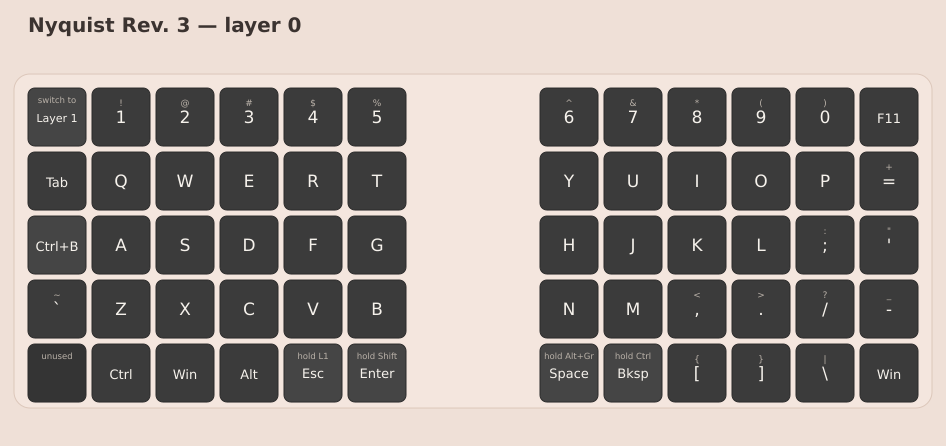
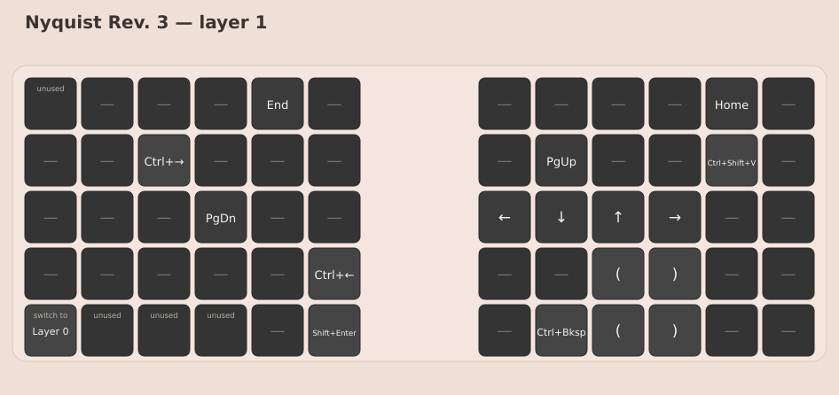

# Nyquist Rev. 3

Split 60% keyboard from Keebio, configured through VIA rather than by building firmware.
Changing the mapping needs no toolchain, no QMK checkout, and no flashing.

- USB ID: `0xCB10:0x3156` (Keebio).
- Layout: `nyquist.layout.json`, four layers, saved from VIA.





## Change the layout

1. Plug the board in over USB.
2. Open [usevia.app](https://usevia.app) in Chrome or Edge.
3. Authorise the Nyquist when the browser asks.
4. Load `nyquist.layout.json` if the board's layout is not already showing.
5. Make the change, then save the layout from VIA and replace this file with it.

The board keeps its own copy in memory, so the change takes effect immediately. This file is
the record that reproduces the mapping elsewhere: re-import it after replacing the board or
clearing its memory.

## If VIA cannot open the keyboard on Linux

Both messages appear together:

```
NotAllowedError: Failed to open the device
Received invalid protocol version from device
```

The second one follows from the first and does not mean the firmware is wrong. VIA reached the
keyboard through WebHID, but the operating system refused the open.

Check the device nodes:

```bash
ls -l /dev/hidraw*
```

The Nyquist nodes should read `root plugdev`. If they read `root root`, install a rule for
this board's IDs:

```bash
sudo tee /etc/udev/rules.d/92-via-keebio.rules >/dev/null <<'EOF'
KERNEL=="hidraw*", SUBSYSTEM=="hidraw", ATTRS{idVendor}=="cb10", ATTRS{idProduct}=="3156", MODE="0660", GROUP="plugdev"
EOF
sudo udevadm control --reload-rules
sudo udevadm trigger --subsystem-match=hidraw
```

Then unplug and replug the board. Replugging alone changes nothing while the rule is missing,
and restarting the browser alone does not help either.
